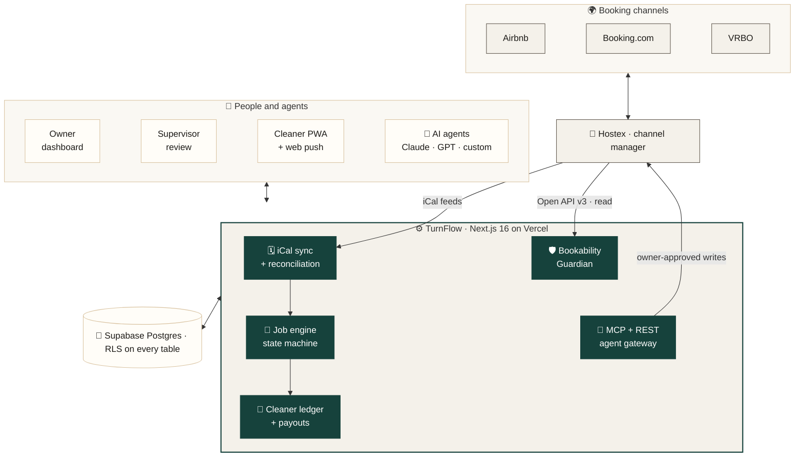
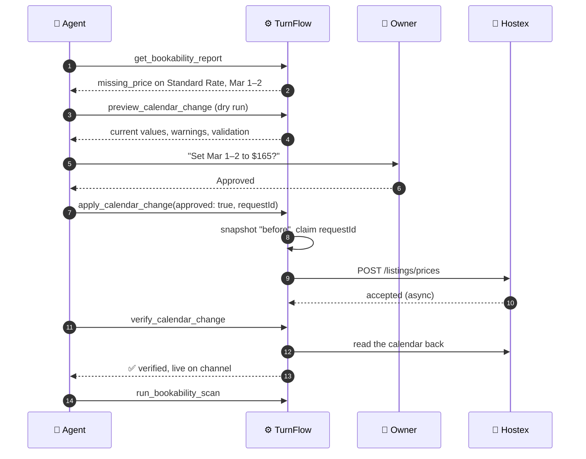
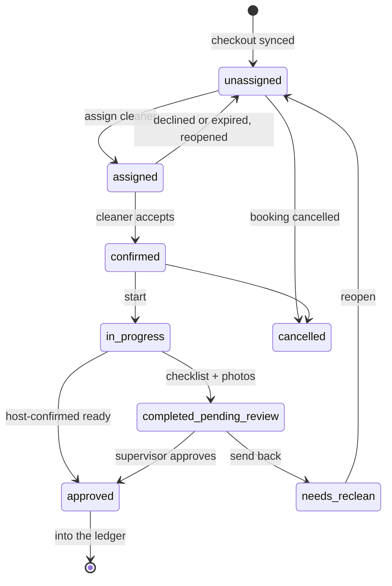

<div align="center">


# TurnFlow

### The operating system for short-term rental turnovers

**Bookings in. Proof out. Cleaners paid. Calendars guarded.**<br/>
**AI agents in the loop, with the owner approving every consequential step.**

<br/>

[](https://nextjs.org)
[](https://react.dev)
[](https://www.typescriptlang.org)
[](https://supabase.com)
[](https://tailwindcss.com)
[](https://vercel.com)

[](#-ai-native-mcp--rest-for-your-agents)
[](#-quality-bar)
[](./supabase/migrations)
[](#-security-is-enforced-in-the-database)
[](#-built-for-three-kinds-of-people)
[](./LICENSE)

[**Live app**](https://str-management-blond.vercel.app) · [**Agent API**](./docs/agent-api.md) · [**Architecture**](./SYSTEM_ARCHITECTURE.md) · [**Decisions**](./ARCHITECTURE_DECISIONS.md)

</div>

<br/>

> [!NOTE]
> TurnFlow is built and run by a working host on a live portfolio of 5 channel-managed listings, across 25 Airbnb and Booking.com calendars. Every feature here exists because a real turnover, payout or booking went wrong without it.

<br/>

## ⚡ In thirty seconds

| Capability | What it does |
|---|---|
| 🗓️ **Calendars create the work** | Every Airbnb, VRBO and Booking.com checkout becomes a cleaning job. Date changes move the job, cancellations cancel it, and the cleaner is told. |
| 📸 **The server demands proof** | A job can't close without its required checklist items and before/after photos. This is enforced on the server, not the UI. |
| 💸 **Money reconciles itself** | Itemized extras, verified payments, audited corrections and running balances per cleaner. Payout statements and a 1099 view come straight from the ledger. |
| 🛡️ **Revenue is guarded** | The **Bookability Guardian** reads all 25 channel calendars daily and flags any night that guests can't book. It found a Booking.com rate plan with 153 open nights and no price. |
| 🤖 **Agents are first-class** | An MCP server and an OpenAPI REST API expose 35 tools. Writes need a write-scoped token, explicit owner approval, idempotency keys and an audit log. |

<br/>

## 🧭 Architecture



<br/>

## 🛡️ Bookability Guardian

Your channel calendars can fail silently: a missing nightly price, a rate plan derived from nothing, a pricing tool that stopped syncing four days ago. When that happens you lose bookings and nobody tells you. The Guardian reads every Hostex channel calendar 180 days ahead, every day and on demand, and judges only the nights the property is really open for sale.

| Rule | Severity | Catches |
|---|:---:|---|
| `missing_price` | 🔴 critical | Sellable nights with no price. It knows when Booking.com prices the plan itself, and points to the extranet fix instead of an API push. |
| `pricing_stale` | 🔴 critical | PriceLabs hasn't pushed a property in 36 hours (read from its own sync record), or TurnFlow-priced calendars haven't changed a price in 72 hours |
| `scan_stale` | 🔴 critical | The scanner itself failed, or hasn't succeeded in 26 hours. The watchdog is watched too. |
| `closed_while_available` | 🟠 warning | The property is open but this calendar has zero inventory |
| `ratio_drift` | 🟠 warning | A rate plan departs more than 2% from its multiplier to Airbnb |
| `restriction_conflict` | 🟠 warning | Closed to arrival or departure on an open night, or a minimum stay above the maximum |
| `far_out_min_stay` | 🔵 info | Minimum stays of 7+ nights on open dates |

Each calendar has exactly **one pricing authority** (PriceLabs, TurnFlow or manual), so two systems can never publish competing rates to it. A finding resolves only when a later *successful* scan stops seeing it. While a critical problem is open, a red banner stays on every dashboard page, and you get a push notification when one first appears.

<br/>

## 🤖 AI-native: MCP + REST for your agents

TurnFlow is an [MCP](https://modelcontextprotocol.io) server. Any MCP-capable agent can read the schedule, assign cleaners, reconcile pay and repair channel calendars, through the same server actions, validation and row-level security the web app uses.

```jsonc
// .mcp.json (Claude Code, Claude Desktop, or any MCP client)
{
  "mcpServers": {
    "turnflow": {
      "type": "http",
      "url": "https://<your-deployment>/api/mcp",
      "headers": { "Authorization": "Bearer tf_<token from Settings → AI agents>" }
    }
  }
}
```

Agents that only speak HTTP can call the same tools through `POST /api/agent/v1/tools/{name}`. An OpenAPI schema is generated from the live tool registry at `/api/agent/v1/openapi.json`.

<details>
<summary><b>The 35 tools</b> (16 read · 19 write)</summary>
<br/>

| Area | Tools |
|---|---|
| **Schedule & jobs** | `list_properties` · `get_schedule` · `list_unassigned_cleanings` · `get_cleaning` · `assign_cleaner` · `unassign_cleaner` · `reschedule_cleaning` · `cancel_cleaning` · `restore_cleaning` |
| **Cleaners** | `list_cleaners` · `suggest_cleaners` |
| **Scope & pay** | `get_cleaning_scope` · `correct_cleaning_scope` · `correct_cleaning_date` · `get_job_pay` · `add_job_extra` · `remove_job_extra` |
| **Ledger & payments** | `get_cleaner_balances` · `get_cleaner_statement` · `record_cleaner_payment` · `verify_cleaner_payment` · `void_cleaner_payment` · `mark_cleanings_paid` · `mark_cleaning_unpaid` · `post_cleaner_adjustment` |
| **Reservation history** | `get_reservation_history` · `import_reservation_history` · `import_reservation_csv` |
| **Bookability & calendars** | `get_bookability_report` · `run_bookability_scan` · `update_channel_listing` · `preview_calendar_change` · `apply_calendar_change` · `verify_calendar_change` · `list_calendar_changes` |

</details>

### How an agent fixes a live calendar



**Guardrails agents can't get around:**
- Read and write tokens are scoped. Every write requires `approved: true`, and every agent write lands in an audit log.
- The client retries with the same idempotency key (`requestId`), which never double-sends. Reusing a key with different details is refused.
- Before any write is sent, TurnFlow refuses to:
  - push prices to channel-derived rate plans
  - write manual prices on calendars that PriceLabs owns
  - send decimal prices, past dates or overlapping ranges
- "Accepted" never counts as "done": a change counts as live only after it is read back from the channel calendar.
- Agent credentials are 60-second ES256 JWTs bound to the token's owner. They never touch the owner's sign-in session.

<br/>

## 🔁 The job lifecycle



Every transition goes through one state machine, [`assignment-status-engine.ts`](./src/lib/services/assignment-status-engine.ts). Two cleaners can't both accept the same job, because acceptance is a conditional update that only succeeds while the job is still open.

<br/>

## 👥 Built for three kinds of people

<table>
<tr>
<td width="33%" valign="top">

### 🧑‍💼 Owner
*Desktop, morning planning*

- Today at a glance: unassigned, at-risk, tight turnovers
- One calendar across every property
- System health and bookability findings
- Cleaner ledgers, payouts, 1099 view
- Property health and reliability scores
- AI agent tokens in Settings

</td>
<td width="33%" valign="top">

### 🕵️ Supervisor
*Tablet, review queue*

- Checklist and photo evidence per job
- Approve, or send back for a re-clean
- Issues, restocks and inventory per property
- Recurring deep-clean tasks

</td>
<td width="33%" valign="top">

### 🧽 Cleaner
*Phone, on site*

- Installable PWA, big tap targets
- Today's jobs, schedule, history
- Door codes and notes on the active job
- Job chat and push notifications
- Their own earnings and pay history

</td>
</tr>
</table>

<br/>

## 🔐 Security is enforced in the database

These aren't UI hints. The database and server code enforce them, so a crafted request can't get around them.

| Guarantee | Enforced by |
|---|---|
| Each host's data is invisible to every other host | Row-level security on every table, scoped by tenant |
| Nobody can raise their own role, change tenants or reactivate themselves | A database trigger on `users`, proven by `tests/db/` |
| A deactivated user loses database access, not just the UI | Role helpers return nothing for inactive users |
| A job can't be submitted without required proof | [`completion-validator.ts`](./src/lib/services/completion-validator.ts) |
| Paid, reconciled or reported money is never rewritten | Corrections append signed adjustments with immutable receipts |
| Owners can change calendar settings but never forge scan results | Column-level grants, verified in `tests/db/bookability.test.sql` |
| Calendar URLs must be public HTTPS | [`url-guard.ts`](./src/lib/ical/url-guard.ts), re-checked on every redirect |
| Cron endpoints fail closed | Every call is refused when `CRON_SECRET` is missing in production |

<br/>

## 🧱 Stack

| Layer | Choice |
|---|---|
| **App** | Next.js 16 App Router · React 19 Server Components and Server Actions · TypeScript 5.8 strict |
| **UI** | Tailwind v4 · Radix primitives · lucide · a warm, calm design system (`#16423c` / `#f4f1ea`) |
| **Data** | Supabase Postgres with RLS everywhere · security-definer RPCs for money paths · Auth · Storage |
| **Validation** | Zod at every boundary: forms, server actions, agent tools, external APIs |
| **Agents** | Model Context Protocol (HTTP) · generated OpenAPI 3 · scoped tokens · ES256 short-lived JWTs (`jose`) |
| **Integrations** | Hostex Open API v3 · RFC 5545 iCal with a dependency-free, time-zone-aware parser |
| **Background** | Vercel Cron: calendar sync, bookability scan, reminders, recurring tasks, weekly digest |
| **Notifications** | Web Push (VAPID) · in-app inbox |
| **Quality** | Vitest · SQL security suites on a throwaway Postgres · `tsc --noEmit` · ESLint 9 |

<br/>

## ✅ Quality bar

<div align="center">

| 482 | 12 | 59 | 35 | 5 |
|:---:|:---:|:---:|:---:|:---:|
| unit tests | RLS and integrity suites | migrations | agent tools | scheduled jobs |

</div>

```bash
npm test             # 482 unit tests: state machine, validator, iCal, reconciliation, ledger, guardian, agent API
npm run test:db      # applies all 59 migrations to a throwaway Postgres, then tries the attacks
npm run typecheck
npm run build
```

`npm run test:db` never touches a Supabase project. It starts a temporary local Postgres, applies every migration, and attempts privilege escalation, cross-tenant reads, self-reactivation, forged payments and forged scan results. Every attack has to fail.

<br/>

## 🚀 Run it locally

<details>
<summary><b>Setup</b> (Node 20+, a Supabase project)</summary>
<br/>

```bash
git clone https://github.com/seancheick/STR-Management.git
cd STR-Management
npm install
supabase link && supabase db push   # apply the schema
npm run dev
```

`.env.local`:

```bash
NEXT_PUBLIC_SUPABASE_URL=
NEXT_PUBLIC_SUPABASE_ANON_KEY=
SUPABASE_SERVICE_ROLE_KEY=
NEXT_PUBLIC_VAPID_PUBLIC_KEY=      # web push
VAPID_PRIVATE_KEY=
VAPID_SUBJECT=
CRON_SECRET=                       # required in production; cron routes refuse every call without it
HOSTEX_API_TOKEN=                  # optional: enables the Bookability Guardian and calendar changes
PRICELABS_API_KEY=                 # optional: lets the Guardian confirm PriceLabs is still pushing prices
AGENT_SIGNING_JWK=                 # optional: ES256 private JWK for agent sessions (see docs/agent-api.md)
```

</details>

<br/>

## 🗺️ Roadmap

- [x] Calendar-driven jobs with proof-of-clean and supervisor review
- [x] Cleaner ledger, verified payments, audited corrections, payout statements
- [x] MCP and REST agent API with approval-first writes
- [x] Bookability Guardian and owner-approved calendar repairs
- [ ] Hostex reservation webhooks in place of iCal mirrors
- [ ] AI guest-messaging copilot with an approval inbox
- [ ] Owner command center: revenue, occupancy and contribution per stay
- [ ] Transparent rules-based pricing engine, shadow-tested against PriceLabs before going live

<br/>

## 📚 Docs

| Doc | What's in it |
|---|---|
| [`docs/agent-api.md`](./docs/agent-api.md) | Connecting agents, every tool, and the calendar-repair procedure |
| [`SYSTEM_ARCHITECTURE.md`](./SYSTEM_ARCHITECTURE.md) | Schema, status machine, business rules |
| [`ARCHITECTURE_DECISIONS.md`](./ARCHITECTURE_DECISIONS.md) | Why things are built the way they are |
| [`docs/JOB_OPERATIONS.md`](./docs/JOB_OPERATIONS.md) | Day-to-day job operations |
| [`docs/MULTI_TENANCY_HANDOFF.md`](./docs/MULTI_TENANCY_HANDOFF.md) | How tenant isolation works |
| [`docs/DB_SECURITY_AUDIT.md`](./docs/DB_SECURITY_AUDIT.md) | Database security review |
| [`INDEX.md`](./INDEX.md) | Map of everything else |

<br/>

<div align="center">

**MIT licensed** · Built by **B&amp;Br Technology** for hosts who'd rather be hosting.

<sub>Calm. Trustworthy. Warm. Like a turnover that went right.</sub>

</div>
